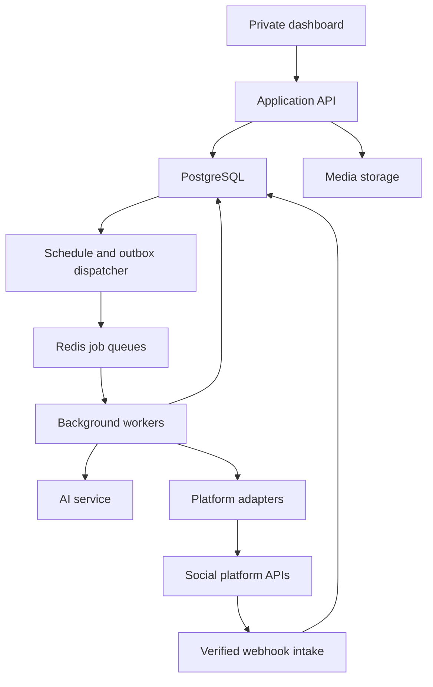
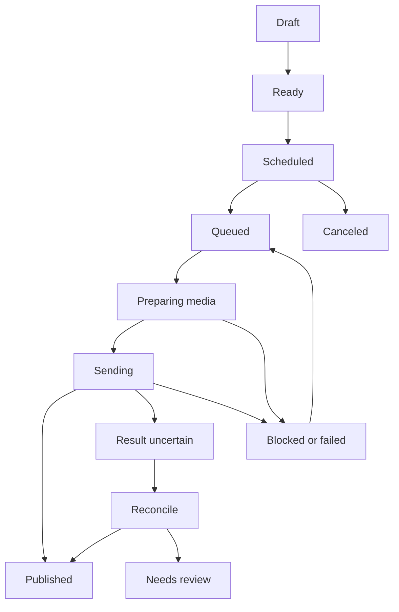

# Social Media Agent — Dashboard and Developer Build Plan

Prepared: 1 October 2026  
Updated: 1 October 2026 — single operator, manual social tokens and AI API keys; no application login or social sign-in flow.  
Scope: one Facebook Page, one Instagram account, one LinkedIn company Page, and one X account.  
Deliverable: implementation specification, code organization, and acceptance criteria. Code examples describe contracts; they are not a deployed application.

## 1. Recommended product

Build one private social media workspace that accepts your existing images and content, prepares a separate version for each selected platform, schedules publication, collects incoming engagement, assists with replies, and reports performance.

Use a modular application with a web dashboard, API, database, and persistent background worker. One AI service can handle several tasks through separate prompts and typed outputs. Four autonomous agents are unnecessary for four accounts.

The AI prepares language and recommendations. Application code owns permissions, account selection, schedules, publish attempts, reply delivery, and analytics calculations. This keeps an AI outage from stopping an already approved scheduled post.

### Decisions for this build

| Decision | Recommendation |
|---|---|
| Workspace | One fixed operator and one fixed workspace; one active account per platform |
| Dashboard access | No registration, login, user management, team roles, or invitations; run on localhost or a private network |
| Account setup | Manually enter already-issued API tokens and account/Page IDs; no social sign-in or OAuth redirect in this dashboard |
| AI setup | Enter the selected AI provider's API key/token and model in Settings |
| One operator at a time | One active dashboard write session; another tab/device is read-only until the editing lease is released or expires |
| Content input | Existing images, ordered image sets, video files when provided, and text |
| Web application | Next.js with React and TypeScript |
| Backend | Node.js with Express and TypeScript, matching your existing backend experience |
| Data | A separate PostgreSQL database for this application |
| Background work | BullMQ with Redis; PostgreSQL remains the source of truth |
| Media | S3-compatible object storage; private originals and temporary delivery URLs |
| Platform integration | Official platform APIs through separate adapters |
| AI integration | A provider-neutral service for rewriting, reply suggestions, classification, and summaries |
| Initial automation | Scheduled approved posts; review replies before sending |
| Later automation | Narrow, permitted Meta reply rules after validation; platform-specific restrictions remain enforced |
| Default timezone | Asia/Kolkata; show IST in the interface and store UTC instants |
| Links | Do not add a link without an explicit placement choice |
| Expansion | Add another platform through a connector, without rewriting the composer or scheduler |

This is a standalone, single-operator application. Keep its database separate from AdsMG production. Later integration can use narrowly scoped APIs without adding a user-login system to this dashboard.

### Revised access requirement

The operator opens the private dashboard directly, pastes social API credentials and AI keys into Settings, validates them, and uses the application. Do not implement password, Google, Facebook, Instagram, LinkedIn, or X login buttons, OAuth callback routes, signup, or team management.

Tokens must already be legitimately issued with the required permissions. Obtaining or renewing them may require authorization in the provider's own developer tools outside this dashboard. Imported credentials do not remove platform approval, permission, expiry, or automation restrictions.

## 2. Platform capabilities and restrictions

Availability has three independent conditions: the platform exposes an API, your application has access, and the supplied token is authorized for the selected account and action. Saving a token does not by itself satisfy all three.

### Capability matrix

| Capability | Facebook Page | Instagram | LinkedIn company Page | X |
|---|---|---|---|---|
| Publish supplied content | Page text and media; validate each format | Professional-account image, carousel, and supported video publishing | Organization posts; text, images, documents, video | Posts and supported media |
| Schedule through our app | Worker sends at the chosen time | Worker sends at the chosen time | Worker sends at the chosen time | Worker sends at the chosen time |
| Read engagement on owned posts | Permission-dependent | Permission-dependent | Community Management access | Endpoint access and usage budget |
| Send a reviewed reply | Page comment permissions | Comment-management permissions | Approved API plus explicit human send | Authenticated account action |
| Unattended replies | Only permitted, configured rules | Only permitted, configured rules | Keep disabled | Keep disabled unless required written platform approval is obtained |
| Post and account analytics | Available metrics only | Available metrics only | Organization analytics access | Available public/owned metrics |
| Direct messages | Separate Messenger integration | Separate messaging integration | Exclude from standard v1 integration | Separate messaging integration and eligibility checks |
| Hide/delete/moderate | Enable individual supported actions | Enable individual supported actions | Show only supported, permitted actions | Manual actions only where permitted |
| Pin a comment, change bio, special native features | Capability check or manual task | Capability check or manual task | Capability check or manual task | Capability check or manual task |

The Facebook row is a proposed integration scope. Some Meta reference pages returned rate-limit errors during this review; confirm its exact endpoints, scopes, media rules, and metric names during Phase 0. Instagram capabilities above are corroborated by Meta's maintained API collection. [S1–S3]

### Important platform facts

**Instagram:** use a Business or Creator account. Store which API product issued the imported token. Meta's Instagram Login product does not require a linked Page; its Facebook Login product does. These are token-origin/API-mode labels in Settings, not login flows to implement in this dashboard. Select the compatible endpoint host, token type, and scope family. [S1, S2]

**LinkedIn:** company Page access uses the vetted Community Management product. Development access is restricted; production Standard access is an approval dependency. The documented development allowance is 500 calls per application and 100 per member per 24 hours, with social-action push notifications disabled. Do not design a rapid polling inbox around development access. [S4, S5]

**LinkedIn replies:** LinkedIn states that comments published without a human action are not allowed. Implement reply suggestions followed by an explicit human Send action. The existence of a comments endpoint does not authorize unattended commenting. [S6]

**X replies and engagement:** AI reply bots require prior explicit written approval from X. Automated responses also require appropriate recipient intent and opt-out handling; automated likes and automated reply hiding are prohibited. Keep these restrictions in backend policy. [S9]

**X costs:** X currently documents credit-based, pay-per-use access. Estimate costs from actual endpoints, returned resources, and account eligibility; show usage limits in Settings. A single connected account does not make all API calls free. [S10]

### Media formats are different

An Instagram carousel must become a deliberately chosen format elsewhere. For LinkedIn, use organic multi-image posts or a PDF document when appropriate; its sponsored carousel API is not the organic carousel implementation. A document can be assembled from your approved slides as a separate export, with ordering and readability checked. [S7]

Do not silently crop text out of artwork, drop carousel slides, publish an unsupported text-only Instagram post, or split content into an X thread. Show the adapted result before scheduling. Each thread item, if enabled later, needs its own delivery record and parent relationship.

## 3. What the agent should do

### Content preparation

1. Accept your supplied copy and media.
2. Keep the original unchanged and create editable platform variants.
3. Suggest a shorter hook, caption, hashtags, accessibility text, or call to action when requested.
4. Preserve product facts, names, numbers, claims, and intended meaning.
5. Validate the platform's current character and media constraints in code.
6. Preview each selected account and format.
7. Ask for link placement only when a link is actually intended.
8. Schedule the exact approved version.

Image generation and GitHub repository analysis are optional future content sources. They are not necessary for this first build because you already have content and images.

### Publishing operations

- Publish now or at a chosen time.
- Save drafts, duplicate an existing post as a new draft, and reorder slides.
- Reschedule or cancel an unpublished delivery.
- Track the result separately for every platform.
- Retry only deliveries known to be safe to retry.
- Recover schedules after a worker restart or queue outage.
- Notify you about failed, blocked, or uncertain results.
- Import a bounded recent history of native posts when access allows, so their comments and analytics can also appear.

### Engagement management

- Collect comments and relevant mentions available through the connected account.
- Classify items as questions, appreciation, complaints, sales interest, spam, or unknown.
- Draft a contextual reply from the post, thread, and your approved knowledge base.
- Offer Edit, Send, Ignore, Resolve, and supported moderation actions.
- Assign high-impact or uncertain questions to you.
- Prevent the worker from answering the same interaction twice.
- Respect a human taking over the conversation.

The inbox covers accessible activity on your owned accounts. Global social listening, competitor scraping, indiscriminate outreach, and follower-growth bots are separate use cases and are not assumptions in this build.

### Analytics and recommendations

- Display available post-level and account-level metrics.
- Track trends, successful formats, response time, and unresolved engagement.
- Compare posts within a platform using the same measurement window.
- Suggest experiments in publishing time, topic, and format.
- Prepare an in-app weekly summary from computed data.
- Keep recommendations editable; do not silently change the content calendar.

## 4. Web dashboard specification

Open on useful work: upcoming posts, replies needing attention, and account connection health. Avoid a marketing homepage inside the private dashboard.

| Screen / route | Main content | Main actions | Essential states |
|---|---|---|---|
| Overview `/` | Upcoming deliveries, pending replies, recent performance, connection alerts | Create post, open inbox, inspect issue | Empty workspace, partial connection, stale analytics |
| Composer `/posts/new` | Content, ordered media, platform variants, account previews, schedule | Save draft, validate, publish, schedule | Saving, upload failed, invalid variant, permission missing |
| Posts `/posts` | Drafts, scheduled, published, partial failures | Filter, edit draft, duplicate, cancel, inspect | Each delivery's real status |
| Post detail `/posts/:id` | Original and variants, approval revision, delivery timeline, metrics | Open native post, retry eligible delivery, inspect failure | Uncertain delivery, native deletion, unavailable metric |
| Calendar `/calendar` | Month, week, and list views; local times and platform badges | Move schedule, edit, cancel, pause | Collision warning, outdated edit, worker paused |
| Media `/media` | Supplied assets, thumbnails, format details, usage history | Upload, reorder in post, archive unused asset | Processing, rejected format, delivery URL unavailable |
| Inbox `/inbox` | Unread, needs review, awaiting user, replied, resolved | Draft, edit, send, resolve, supported moderation | Deleted comment, no permission, human takeover |
| Analytics `/analytics` | Platform tabs, date range, post table, trends, freshness | Compare, inspect metric definition, export | Not available, not authorized, not yet collected |
| Automation `/automation` | Publishing and reply rules; active limits | Enable supported rule, pause, test on saved example | Blocked by policy, rule changed, budget reached |
| Knowledge `/knowledge` | Approved facts, FAQs, voice, exclusions, link preferences | Add, edit, archive, approve | Outdated fact, conflicting answer |
| Accounts `/accounts` | Four account cards; verified account IDs, token status, capabilities, expiry | Open token settings, validate, replace token, disable account | Token missing, expired, wrong account, permission missing |
| Activity `/activity` | Post, reply, sync, and rule-change history | Filter, inspect sanitized error, open affected item | Retry pending, final failure |
| Settings `/settings` | Social token forms, AI API keys/models, timezone, alerts, budgets, retention | Save and validate credentials, replace key, clear credentials, export non-secret data | Masked saved secret, failed validation, expired token |

### Composer details

Use a three-part desktop layout: supplied content and assets; platform-specific editing; a preview of the selected variant. On mobile, present these as consecutive tabs with a persistent Save/Schedule action.

The scheduling confirmation must show account names, exact local date/time, timezone, selected media order, variant revision, and expected link behavior. One scheduling action can approve all selected variants. Requiring four separate approval clicks is unnecessary.

If a scheduled caption, asset, destination account, or link policy changes, invalidate its previous content approval. A schedule-only change creates a new schedule version and records a new scheduling instruction without silently altering the approved content.

### Calendar and status behavior

- Dragging a card updates the server using its current version; show a conflict if another tab changed it.
- Display platform delivery badges inside a grouped content card.
- Use labels such as “Published on 3 of 4 accounts” instead of claiming complete success.
- A published item links to the actual remote post ID/permalink.
- Cancellation only applies before dispatch. Once sending begins, explain that the platform result must be checked first.
- Pause controls stop new dispatches; an already accepted external request may still complete.

### Inbox behavior

Use a list of interactions, the selected thread with original post, and a reply editor. Show “AI suggestion” on generated text and show who actually sent a reply. On small screens, use one pane at a time.

A reviewer can edit and send directly. A reply queued by a permitted rule must recheck that no human has answered or taken over before it sends. Do not expose an automatic-reply toggle on a platform where it cannot be enabled.

### Interface quality

Use readable type, accessible contrast, keyboard navigation, labeled controls, visible focus, and responsive layouts. Avoid loading the entire account history at once. Paginate post and inbox lists, lazy-load media thumbnails, and retain filter state in the URL.

Every empty chart should say why it is empty. Do not display fabricated example metrics in the live workspace. If a separate demo mode is used during development, label it and isolate its records from production.

## 5. Architecture and technology

### Recommended stack

| Layer | Selection | Purpose |
|---|---|---|
| Web | Next.js, React, TypeScript | Responsive dashboard and routing |
| UI | Tailwind CSS with accessible components | Consistent forms, dialogs, tables, and navigation |
| Server data | TanStack Query | Cached server state, pagination, targeted refresh |
| Forms | React Hook Form and Zod | Form behavior and shared validation schemas |
| Charts | Recharts | Platform trends and post comparisons |
| API | Express, TypeScript, Zod, OpenAPI | Typed, versioned business endpoints |
| Database | PostgreSQL and Prisma | Durable schedules, relations, constraints, and reporting |
| Jobs | BullMQ and Redis | Background execution and bounded retry scheduling |
| Storage | S3-compatible object storage | Originals, derived platform assets, reports |
| Media processing | Sharp; FFmpeg when video is enabled | Deterministic resizing, validation, transcoding |
| AI | One configurable provider adapter | Structured drafts, classification, summaries |
| Logs | Pino and OpenTelemetry-compatible instrumentation | Correlated, redacted diagnostics |
| Testing | Vitest, API integration tests, Playwright | Delivery invariants and critical user journeys |
| Deployment | Containerized API/worker/web plus managed data services | Continuous execution and separate deployment concerns |

Pin supported package versions and a supported Node.js LTS version during implementation. Commit the lockfile. Exact package versions are intentionally not frozen in this planning document.

PostgreSQL is recommended for this new application's relational deliveries, approvals, and reporting. Keeping MongoDB is also viable if reusing an existing service is essential, but then implement the same uniqueness, transaction, outbox, and reconciliation guarantees. Do not migrate your unrelated existing applications for this project.

### Runtime topology



This is a modular monolith with separate runtime processes. Start with one worker deployment, not a microservice per platform. Split workers only when load or operational isolation requires it.

### API, MCP, and workflow tools

Use platform APIs inside the connectors. MCP is an optional interface through which a conversational client can call your own approved application actions; it does not replace platform permissions or scheduling infrastructure.

You do not need LangGraph, a separate agent framework, or n8n to implement the initial workflow. If n8n is added later for internal notifications, keep one authoritative publishing scheduler. Avoid two systems independently sending the same scheduled post.

### Separate AI from external side effects

The model can propose `draft_variants`, `suggest_reply`, `classify_interaction`, `propose_calendar`, and `summarize_metrics`. Application services validate these proposals. Tokens, direct database access, unrestricted HTTP tools, and publishing credentials never enter the model prompt.

An optional command such as “Schedule this on all four accounts tomorrow at 6 PM” must resolve to explicit account IDs, a timezone-aware timestamp, an immutable content revision, and a preview. The operator's explicit scheduling action through the private dashboard supplies authorization. Chat wording alone must not bypass the same service checks used by the dashboard.

## 6. Code organization

Use a pnpm monorepo. Keep business services independent of HTTP requests and queue job objects, so both the API and worker use the same checks.

| Repository path | Responsibility |
|---|---|
| `apps/web/src/app/` | Dashboard routes and layouts |
| `apps/web/src/features/composer/` | Original content, variants, media ordering, previews |
| `apps/web/src/features/calendar/` | Calendar and scheduling UI |
| `apps/web/src/features/inbox/` | Threads, suggestions, manual send, moderation UI |
| `apps/web/src/features/analytics/` | Charts, definitions, comparisons, exports |
| `apps/web/src/features/accounts/` | Bound account identity, token health, and capability display |
| `apps/web/src/features/settings/credentials/` | Manual social-token and AI-key forms; masked status and replacement |
| `apps/api/src/server.ts` | HTTP bootstrap, middleware, health endpoints |
| `apps/api/src/routes/v1/` | Private-network API handlers with origin, CSRF, and write-lease checks |
| `apps/api/src/routes/v1/credentials.ts` | Write-only secret submission, validation, replacement, and removal |
| `apps/api/src/routes/webhooks/` | Platform-specific signature validation and intake |
| `apps/worker/src/main.ts` | Worker bootstrap and graceful shutdown |
| `apps/worker/src/processors/` | Publish, reconcile, inbox, AI, and analytics jobs |
| `apps/worker/src/dispatchers/` | Due schedule scans and outbox delivery |
| `packages/core/src/posts/` | Drafts, revisions, variants, validation, approvals |
| `packages/core/src/publishing/` | Delivery state machine and idempotency controls |
| `packages/core/src/inbox/` | Interaction state, reply decisions, human takeover |
| `packages/core/src/analytics/` | Metric normalization and aggregate calculations |
| `packages/core/src/policies/` | Capability, link, automation, and budget checks |
| `packages/core/src/credentials/` | Encryption, identity binding, credential versions, expiry, refresh eligibility |
| `packages/core/src/operator/` | Single-operator write lease and request protection; no login module |
| `packages/adapters/src/facebook/` | Page publishing, engagement, insights |
| `packages/adapters/src/instagram/` | Imported-token/API-product-specific Instagram behavior |
| `packages/adapters/src/linkedin/` | Organization APIs and access-tier behavior |
| `packages/adapters/src/x/` | X endpoints, cost accounting, account permissions |
| `packages/adapters/src/contracts.ts` | Shared adapter input/output contracts |
| `packages/ai/src/` | Provider implementation, prompts, schemas, evaluations |
| `packages/db/prisma/` | Schema, migrations, seed data for local development |
| `packages/db/src/` | Database client and repository helpers |
| `packages/contracts/src/` | Request/response types, Zod schemas, event schemas |
| `packages/observability/src/` | Correlation IDs, redaction, logger, telemetry |
| `tests/integration/` | Database, job, webhook, and connector contract tests |
| `tests/e2e/` | Critical dashboard journeys |
| `docs/` | OpenAPI output, permission map, metric dictionary, runbooks |
| `infra/` | Container definitions, local compose, deployment examples |

Within a domain module, use `schema.ts`, `service.ts`, `repository.ts`, and focused policy files. Controllers enforce private-access and request checks and validate input, services enforce domain rules, repositories persist data, and adapters speak to platforms. Avoid putting publish logic in React components or duplicating it in controllers and workers.

## 7. Database model

Store platform IDs as strings; their lengths and shapes are outside your control. Use internal UUIDs for your own entities. Retain one fixed workspace record for organization; resolve it on the server rather than accepting a client-supplied workspace ID. There is no user, membership, role, or login-session table.

| Table | Main fields | Important rule |
|---|---|---|
| `workspaces` | fixed `id`, operator label, `timezone`, `publishing_paused` | Exactly one workspace; no user foreign key |
| `operator_leases` | fixed workspace, browser reference, per-tab instance ID, fencing version, heartbeat, expiry | At most one active dashboard writer; not a login credential |
| `api_credentials` | provider, auth type, token origin, active version ID, safe fingerprint, status | Metadata only; covers social platforms and AI providers |
| `credential_versions` | credential ID, version, encrypted secret reference, scopes, expiry, validation state | Pending/active/retired versions; never expose stored secret values |
| `ai_provider_configs` | provider, credential ID, model, budget, validation state | Provider key managed through Settings |
| `social_accounts` | workspace, platform, remote account ID, credential ID, display name, status | One active account per platform; verify token/account binding |
| `account_capabilities` | account, action, state, reason, checked time, API version | UI and workers read the same result |
| `assets` | workspace, object key, MIME, size, dimensions, checksum, processing state | Retain approved assets used by pending deliveries |
| `asset_derivatives` | original asset, transformation spec, object key, checksum | Never overwrite original |
| `content_items` | workspace, title, original text, current revision | Groups related platform variants |
| `content_revisions` | content item, revision number, source text, asset order, created by | Immutable after approval |
| `post_variants` | content revision, account, platform text, format, selected assets, link policy | One explicit target variant |
| `approvals` | variant, content hash, actor, timestamp, policy version | Approval applies to that exact payload |
| `publications` | variant, account, state, due UTC, schedule version, lease, remote ID | One durable delivery per intended publication |
| `publish_attempts` | publication, attempt number, request correlation, outcome, remote container IDs | Append each attempt; retain reconciliation evidence |
| `outbox_events` | type, aggregate ID, payload, dispatch state, available time | Written in the same transaction as the domain change |
| `webhook_events` | provider, account, external event key, payload reference, received time, state | Deduplicate before processing |
| `sync_cursors` | account, sync type, cursor/watermark, last success | Advance only after storing a completed page |
| `interactions` | account, external ID, parent/root IDs, author reference, text, status | Unique external interaction within its account |
| `reply_actions` | interaction, proposed text, revision, mode, decision, sender, remote reply ID | One initial automated response per eligible interaction |
| `automation_rules` | account, trigger, allowed intents, limits, mode, version, active | Version and audit every activation/change |
| `contact_preferences` | account, remote author ID, opt-out, human takeover state | Check before preparing and sending a response |
| `knowledge_entries` | approved facts/FAQs, revision, owner, review date | Ground generated answers |
| `metric_samples` | account/publication, metric key, value, window, observation time, definition version | Preserve metric meaning and freshness |
| `ai_runs` | task, model/provider, prompt version, source references, usage, sanitized result | Track quality and cost without tokens |
| `audit_events` | actor (`operator` or worker name), action, target, safe changes, timestamp, correlation ID | Single-operator history; never record secret values |

### Core constraints and indexes

- A partial unique index on `social_accounts(workspace_id, platform)` where the account is active.
- Unique `post_variants(content_revision_id, social_account_id)`.
- Unique `publications(post_variant_id)` for the initial distribution. Reposting creates a new content item/variant and explicit new authorization.
- Unique remote post ID per account when the remote ID is present.
- Unique `publish_attempts(publication_id, attempt_number)`.
- Unique `interactions(social_account_id, external_interaction_id)`.
- Unique provider webhook key when a stable key exists; use a documented account/event fingerprint otherwise.
- A uniqueness rule for the automated response action keyed by account, interaction, and response purpose. Changing a rule version must not make an already-answered interaction eligible again.
- Index due publications by state and `scheduled_at_utc`; index inbox by account, status, and received time.
- Index metrics by account/publication, metric, metric period, and observation time.

Add a numeric `version` to editable aggregates for optimistic concurrency. Return `409 Conflict` when a client edits an outdated version. Preserve canceled and deleted statuses in operational history rather than losing their delivery records.

### Metric storage contract

```typescript
type MetricSample = {
  accountId: string;
  publicationId?: string;
  key: string;                  // e.g. platform-specific native metric key
  value: number | null;
  availability: "available" | "not_supported" | "not_authorized"
    | "not_collected" | "expired";
  aggregation: "cumulative" | "period" | "gauge";
  windowStart?: string;
  windowEnd?: string;
  observedAt: string;
  sourceTimezone?: string;
  definitionVersion: string;
};
```

Use `null` and an availability reason when the API cannot provide a value. Use zero only when the platform actually returned zero or the value is a valid computed zero.

## 8. Manual tokens, AI keys, and platform adapters

### Credential setup flow — no login

1. Open the dashboard directly on localhost or its private network address.
2. Open **Settings → API credentials**.
3. Select Facebook, Instagram, LinkedIn, X, or an AI provider.
4. Enter the fields for that credential type, including the target Page/account ID where needed.
5. Click **Save and validate**. Send the secret once to the backend over the protected connection; encrypt it as a pending credential version.
6. The backend performs a supported read-only identity/permission check. Do not publish a test post or send a test reply automatically.
7. Show the verified destination name/ID, known permissions, expiry if available, and separate capability results. Never treat the entered account ID as proof of access.
8. Activate a valid token for the same account atomically. A failed replacement preserves the previous credential if it remains valid.
9. Clear secret values from the form. Subsequent screens show only a saved indicator or masked fingerprint and status.
10. Use **Replace token**, **Validate**, **Disable**, or **Remove credentials** for maintenance. No redirect to social login is part of this application.

The tokens are generated externally through the provider's legitimate developer/authorization tools. For example, LinkedIn documents a developer-portal token generator. Upstream consent or authorization can still be necessary to obtain a usable token. [S14]

### Fields to enter in Settings

| Service | Required input for the chosen mode | Optional/conditional input | What validation establishes |
|---|---|---|---|
| Facebook Page | Page ID and the appropriate Page access token | Related Meta app configuration only if required for token inspection, request proof, or webhooks | Token's target Page, effective scopes where inspectable, individual action readiness |
| Instagram | Professional account ID, issued access token, and token-origin/API mode | Linked Page ID for the Facebook-derived mode; relevant app configuration if needed | Correct API product/host and access to that professional account |
| LinkedIn company Page | Organization ID/URN and authorized member access token with organization permissions | Refresh token and corresponding app credentials only when the app is eligible for programmatic refresh | Token validity and organization role/access where available |
| X — OAuth 2.0 user token | User access token and expected account ID/handle | Issued refresh token and client configuration for permitted refresh | User identity and endpoint-compatible permissions |
| X — OAuth 1.0a option | Consumer API key, API secret, access token, and access-token secret | Expected account ID/handle | Signed user-context requests for supported endpoints |
| AI provider | Provider, API key/token, and selected model | Provider-specific project/account field; an allowlisted custom endpoint if supported | Credential validity and model access to the extent the provider exposes them |

Implement one X authentication mode per credential record. A generic app-only X bearer token is suitable for supported public reads, but cannot publish on behalf of your account. [S15–S17]

AI API keys are managed in the same screen as social credentials. Accept provider-issued API credentials, not website login cookies. A subscription to a provider's consumer chat product is not itself an API credential. If a provider has no suitable read-only validation endpoint, show **Not yet tested** and offer a clearly labeled, small **Test model** request that may consume credits.

Do not ask for every possible app secret by default. Reveal only fields required by the selected token mode and enabled features. A shared Meta credential may serve compatible account actions, but Facebook and Instagram retain independent destination IDs, capabilities, and histories.

### Permissions still apply

The backend must keep an endpoint-to-permission map and validate the supplied credential against it. Representative checks are Page publishing/engagement permissions for Facebook, the correct Instagram scope family, organization access for LinkedIn, and user-context write/media permissions for X. Complete the Meta endpoint checks identified in Phase 0.

Keep the two Instagram API products distinct. LinkedIn's Community Management migration also changes some social-action permission names. The presence of a token does not authorize actions outside its actual scopes. [S1, S2, S8]

Keep `META_GRAPH_VERSION` and `LINKEDIN_API_VERSION` explicit in configuration. Validate supported versions before release and maintain a planned upgrade date. Do not copy obsolete API versions from a sample.

### Credential screen behavior

Display separate results for **Credential valid**, **Correct account**, **Publishing permission**, **Replies**, **Analytics**, and **Expiry**. A successful read call cannot prove an untested write capability; label unknown write readiness accurately until scope inspection or an explicit integration test confirms it.

Use statuses `not_configured`, `validating`, `active`, `limited`, `expiring`, `expired`, `invalid`, `revoked`, and `disabled`. Show expiry as **Unknown** if the provider does not supply it. Distinguish invalid credentials, missing scope, insufficient credits, unavailable model, and rate limits.

The operator can replace a token without re-entering content or recreating schedules. If the replacement belongs to a different remote account, reject the ordinary replacement. Switching the destination is a separate explicit action that pauses pending deliveries; never silently send old scheduled posts to a new account.

### Credential persistence contract

```typescript
type CredentialMetadata = {
  id: string;
  provider: string;
  authType: "page_token" | "instagram_user_token"
    | "oauth2_user_token" | "oauth1_user_credentials" | "api_key";
  originMode?: string;
  currentVersion: number;
  secretConfigured: boolean;
  maskedFingerprint?: string;
  verifiedAccountId?: string;
  status: "not_configured" | "validating" | "active" | "limited"
    | "expiring" | "expired" | "invalid" | "revoked" | "disabled";
  expiresAt: string | null;
  lastValidatedAt: string | null;
  refreshMode: "manual_replace" | "provider_supported";
};
```

This is the browser-visible metadata contract. Secret payloads are separate encrypted records available only to backend credential services. Do not offer a GET endpoint, report export, or log view that returns a stored full token.

### Token lifecycle

- Encrypt access tokens, refresh tokens, API keys, and token secrets at rest; keep the encryption key outside the database.
- Never persist submitted secrets in browser local storage, form drafts, frontend bundles, prompts, analytics, or request logs.
- Default to manual replacement. Programmatic renewal is enabled only when that provider, grant, token type, and supplied app credentials support it.
- LinkedIn programmatic refresh is restricted to eligible applications; a pasted access token alone does not guarantee automatic renewal. [S14]
- X OAuth 2.0 renewal requires the issued refresh credential and applicable client configuration; record actual expiry information rather than assuming permanence. [S15]
- Serialize refresh and atomically replace rotating credentials. Workers resolve the active credential at dispatch time; jobs never contain token values.
- Suggest expiry alerts seven days, one day, and one hour before a known expiry, adjusted to the token's lifetime. The app still performs capability/health checks for tokens without a known expiry.
- On expiry/revocation, pause affected external actions and show **Replace token**. Preserve schedules and drafts. Resume only valid, authorized work that still fits the configured lateness policy.
- Recheck identity and permissions after every replacement or refresh. Prevent a changed credential from silently rebinding an account.
- Removing a credential disables dependent actions and deletes its secret. Revoke it remotely if supported and explicitly requested; local removal alone is not a claim of provider-side revocation.

### One active operator at a time

Use one dashboard editing lease per installation. The first private dashboard session acquires it; other tabs/devices can view data but must wait or explicitly request takeover before changing content, sending replies, or editing credentials. A proposed default is a 20-second heartbeat and a 90-second lease expiry, with a fencing version checked on every mutation.

An opaque, automatically issued HTTP-only browser reference plus a distinct per-tab instance ID identifies the lease holder without a login screen. Cookies alone cannot distinguish tabs. Issue each page instance its own handle, bind the lease to that handle and the browser reference, and check the current fencing version on mutations. Keep the handle in page memory, separate from all social credentials. This is concurrency control, not identity verification; access comes from the local/private network boundary. Background workers continue independently after the dashboard closes, subject to approved schedules and rules.

### Shared adapter contract

The following contract intentionally leaves platform-specific media objects inside the adapter. Concrete exported types must be implemented in `packages/contracts`.

```typescript
type Platform = "facebook" | "instagram" | "linkedin" | "x";

type CapabilityState =
  | "available"
  | "missing_permission"
  | "approval_required"
  | "unsupported"
  | "policy_disabled";

type PublishOutcome =
  | { kind: "published"; remoteId: string; permalink?: string }
  | { kind: "processing"; remoteOperationId: string }
  | { kind: "not_sent"; retryable: boolean; code: string }
  | { kind: "unknown"; correlationId: string };

type ReconciliationOutcome =
  | { kind: "found"; remoteId: string; permalink?: string }
  | { kind: "definitely_not_created"; evidenceRef: string }
  | { kind: "pending"; nextCheckAt: string }
  | { kind: "unresolved"; reason: string };

interface SocialAdapter {
  readonly platform: Platform;
  checkCapabilities(accountId: string): Promise<Record<string, CapabilityState>>;
  validate(input: ApprovedVariant): Promise<ValidationResult>;
  prepareMedia(input: MediaPreparation): Promise<PreparedMedia>;
  publish(input: PublishRequest): Promise<PublishOutcome>;
  reconcile(input: PublishAttempt): Promise<ReconciliationOutcome>;
  listInteractions(input: InteractionCursor): Promise<InteractionPage>;
  sendReply?(input: AuthorizedReply): Promise<ReplyOutcome>;
  fetchMetrics(input: MetricsRequest): Promise<MetricSample[]>;
  moderate?(input: AuthorizedModeration): Promise<ModerationOutcome>;
}
```

Each action checks capabilities before execution. An optional method does not mean all accounts can use it. The adapter also maps platform errors into a shared error taxonomy without discarding the original safe diagnostic code.

### Connector implementation notes

| Connector | Required behavior |
|---|---|
| Facebook | Select the correct Page identity; implement separate text/photo/video paths; persist remote upload IDs; normalize comments and insights after confirming their current contracts |
| Instagram | Create media containers near delivery time, persist their IDs, wait for media readiness, publish, and verify; check publishing quota and asset URL availability |
| LinkedIn | Upload assets, persist asset URNs, publish as the selected organization through Posts API; use required version headers; respect development-tier restrictions |
| X | Upload supported media, persist media IDs, publish through the supported write endpoint; account for endpoint costs and rate budgets; keep thread items as separate deliveries |

Treat platform container/media expiry as a connector concern. A post scheduled weeks away should not depend on an upload container or signed URL created today still being valid.

### Access approval work

Start any required access requests early. Record application ID, product/tier, requested use case, submitted date, reviewer feedback, and a working demonstration link. Show the actual manual-token setup and implemented features honestly. If a provider's approval process requires an authorization demonstration, document how the token was legitimately issued externally and confirm that the intended single-operator integration is an accepted use case; do not invent a dashboard login flow.

For development with your own accounts, use legitimate app roles/test access where available. Do not assume that managing only one account automatically exempts the app from every review or production restriction.

## 9. Publishing and scheduling design

### Content versus delivery

A content item can have four variants and four publications. Store these separately. “Publish to all” starts four independent deliveries; it is not a transaction across social platforms.

If Facebook succeeds and Instagram fails, retain the Facebook result. Retry or fix only Instagram. Do not delete successful posts to simulate an atomic rollback.

### Delivery state machine



The `Blocked or failed → Queued` transition requires a known-safe retry or a resolved blocker. A scheduled item can enter the queue only at or after its due time, except for preparatory media work that cannot publish.

### Scheduling algorithm

1. In one database transaction, verify approval, create/update the publication's UTC due time, increment its schedule version, and write an outbox event.
2. A dispatcher reads due records and emits stable job IDs such as `pub-<publicationId>-s<scheduleVersion>`.
3. Jobs contain internal IDs and versions, not tokens or large media payloads.
4. The worker acquires a database-backed lease/conditional claim and checks the current schedule version.
5. Re-read pause state, cancellation state, account authorization, payload hash, time, capability, and budget immediately before dispatch.
6. Prepare assets and call the adapter.
7. Persist the external outcome and its evidence. Release the lease or move into reconciliation.
8. Queue subsequent analytics collection separately.

The outbox dispatcher can start with a 30-second scan interval. This is an engineering default, not a platform guarantee. Store long-term schedules in PostgreSQL; use queue delays only as an execution convenience. A reconciliation scan must recover due work after Redis loss or a dispatcher crash.

### Timezone example

A schedule for **2 October 2026 at 6:00 PM IST** is stored as `2026-10-02T12:30:00Z` with `timezone = "Asia/Kolkata"`. Show both timezone and local date on confirmation. If additional timezones are introduced, explicitly resolve ambiguous or nonexistent daylight-saving times.

Define a late-delivery policy. A reasonable initial product rule is to send up to 15 minutes late, then mark the item for review rather than silently publishing hours after the intended moment. Make this setting visible and configurable.

### Duplicate prevention and uncertain outcomes

Queue deduplication alone is insufficient. Keep database uniqueness, immutable approved payloads, job/version checks, and durable attempt records. BullMQ recommends designing jobs so retries do not change their intended final effect. [S12]

External APIs do not all provide idempotent creation. If a request times out after the platform might have accepted it, a second create can produce a duplicate. Mark the attempt as uncertain and reconcile using a known container/operation ID or supported lookup. Similar text in a recent feed is evidence to inspect, not definitive proof of identity or absence.

If the connector cannot establish the outcome reliably, ask for a manual check of the native account. Do not promise exactly-once publication across every platform. The objective is to avoid duplicate attempts and make uncertainty visible.

### Safe worker outline

```typescript
// Service-level pseudocode: collaborators require real implementations.
async function executePublication(job: PublicationJob): Promise<void> {
  const claim = await publications.claimCurrentVersion(job);
  if (!claim) return; // canceled, already completed, stale, or leased elsewhere

  try {
    const context = await publishing.loadAuthorizedContext(claim);
    await publishing.assertReady(context); // time, account, approval, policy, pause
    const adapter = adapters.forPlatform(context.platform);
    const media = await adapter.prepareMedia(context.mediaPreparation);

    // Atomically establish that this version has entered dispatch.
    // No open DB transaction spans the remote HTTP request.
    const attempt = await publishing.beginDispatch(claim, context, media);
    if (!attempt) return;

    let outcome: PublishOutcome;
    try {
      outcome = await adapter.publish(attempt.request);
    } catch (error) {
      // Once dispatch started, an unclassified transport error is ambiguous.
      outcome = { kind: "unknown", correlationId: attempt.correlationId };
    }
    await publishing.recordOutcome(attempt.id, outcome);
  } finally {
    await publications.releaseLease(claim);
  }
}
```

Preparation failures have their own classification before dispatch. A crash after `beginDispatch` is recovered by a watchdog into reconciliation, never by blindly starting another external create. The dispatch transition should also recheck pause, cancellation, approval validity, and current lease fencing token.

### Retry and error taxonomy

| Outcome | Application response |
|---|---|
| Missing permission or revoked token | Block affected account jobs and request a replacement token or corrected permissions |
| Invalid caption or media | Return to correction workflow; do not loop retries |
| Explicit rate-limit rejection | Honor platform retry timing and remaining schedule deadline |
| Connection failure proven before submission | Retry with a bounded backoff |
| Timeout, ambiguous server error, lost response | Reconcile first |
| Media still processing | Poll that known operation with a limit |
| Remote post confirmed | Record publication ID/permalink and stop create attempts |
| Quota/credit exhausted | Block affected jobs, show the reason, alert owner |
| Unsupported action | Disable the action and offer the appropriate manual workflow |

Use a small retry budget, such as three retryable attempts with exponential backoff and jitter, while honoring provider headers. BullMQ provides configurable attempts and backoff; the domain service must decide which failures are actually retryable. [S13]

## 10. Inbox, replies, and moderation

### Event ingestion

1. Receive a webhook through a public HTTPS endpoint where supported and granted.
2. Validate the provider's signature/challenge requirements against the raw request where required.
3. Persist the event and deduplication key before returning success.
4. Process asynchronously into normalized interactions.
5. Load the original post and bounded thread context.
6. Apply account, contact, human-takeover, and existing-response checks.
7. Classify and propose a reply if eligible.
8. Route to human review or a narrowly enabled rule.

If durable intake fails, return a retryable error rather than acknowledging an event that will be lost. Handle duplicate delivery, out-of-order edits, and deletion events.

Use cursor-based polling when push delivery is unavailable. Poll recent active threads first, keep a watermark, and periodically reconcile missed events. Polling frequency must fit the actual app/member limit and budget; show delayed inbox freshness when operating in a restricted tier.

### Three response modes

| Mode | Behavior | Initial setting |
|---|---|---|
| Suggestions | AI prepares text; owner edits and sends | On for permitted data and supported reply channels |
| Reviewed send | Owner approves that exact response and triggers delivery | On |
| Rule-based automatic reply | Only allowed intent + grounded answer + permitted channel + remaining budget | Off until a supported rule is configured and validated |

Do not provide an unrestricted “reply to everything” switch. A rule contains account, owned-post scope, matching intent, approved knowledge source, language behavior, link behavior, quiet hours, expiration, per-contact limit, total limit, and stop conditions.

### Routing decisions

| Interaction | Recommended behavior |
|---|---|
| Simple appreciation | Short suggested acknowledgment; optionally use an eligible narrow rule |
| FAQ with an approved answer | Grounded suggestion with its internal fact reference |
| Specific technical question | Draft only when supported by the provided information; otherwise ask owner |
| Complaint or refund request | Human review; never invent a resolution |
| Sales interest | Suggest a useful response; do not invent price or availability |
| Request for a link | Apply the owner's approved placement policy and the recipient/channel eligibility |
| Spam or abusive content | Flag; perform only explicitly enabled, supported moderation |
| Unknown, ambiguous, or conflicting question | Escalate without an unsupported answer |
| Already answered, opted out, or human takeover | Suppress automated action |

A model's self-reported confidence is insufficient to authorize a reply. Require grounding, deterministic rule matches, and tested behavior on representative examples. Keep real business decisions with the owner.

### Race prevention

Reserve a reply action transactionally before generating or sending it. A unique automated-response key survives rule edits, event redelivery, and worker restarts. Before sending, recheck the interaction version, deletion state, takeover state, and whether a human reply arrived. Human sends and automatic sends must use the same reservation service.

Store a sent reply's remote ID and use the same uncertain-outcome approach as publishing. Do not re-answer a comment because an HTTP response was lost.

### Direct messages as a separate delivery phase

Build private messaging only after public publishing and inbox handling work. Its capability must include account access, an eligible recipient interaction, applicable message window, and opt-out state. Conversation data may be more sensitive than public comments, so apply stricter storage and model-input controls.

Instagram messaging is a distinct API feature; Meta's collection describes user-initiated conversations. A public comment should not be treated as an unlimited messaging permission. Implement any special private-reply workflow only after checking its current endpoint rules. [S3]

Do not assume a standard LinkedIn company inbox API is available to this application. Offer a native-platform link until specifically supported access is established.

## 11. Link placement policy

Carry forward your preference: the agent must not insert a link into a caption, first comment, private message, or image without an explicit choice.

Store link policy separately from caption text:

```typescript
type LinkPolicy = {
  mode: "none" | "caption" | "first_comment" | "approved_dm" | "manual_bio";
  approvedUrl?: string;
  accountId: string;
  approvedBy?: string;
  approvedAt?: string;
};
```

Default to `none`. A source URL can remain in private reference data without becoming public content. Inspect captions and generated replies for URLs; flag links already embedded in supplied artwork for review rather than silently modifying the image.

“First comment” and “pinned comment” are different actions. Implement only the supported comment operation; create a manual pinning task if pinning is not available. Apply the channel's comment policy to a first comment too. Link placement preference never overrides messaging eligibility or a platform action restriction.

Adding UTM parameters, redirect tracking, QR codes, or a shortened link also changes public content and requires the chosen link policy. Do not claim click attribution for a post that contains no measurable link.

## 12. AI service and knowledge design

### Task contracts

| Task | Input | Structured output |
|---|---|---|
| Adapt supplied content | Original copy, selected assets, platform, voice rules | Caption, suggested hashtags, accessibility text, factual-change warnings |
| Classify interaction | Comment, bounded thread, original post | Intent, language, risk flags, relevant knowledge IDs |
| Suggest reply | Approved facts, context, link policy | Draft, source fact IDs, reasons for review |
| Propose calendar | Approved drafts, user availability, observed performance | Proposed slots and rationale |
| Summarize analytics | Backend-computed metrics and comparisons | Findings, limitations, suggested experiments |

Use schema validation on every response. Store prompt version, model identity, task, usage, and result. Reject an invalid response or make a single bounded repair attempt; do not run an indefinite model loop.

### Knowledge base

Start with approved facts and FAQs in PostgreSQL. For a small single-brand workspace, full-text search or a direct bounded selection of relevant entries is enough. Add embeddings only when retrieval quality or content size makes them useful.

Facts should have an owner, revision, source, review date, and status. Reply drafts reference the fact IDs used. Removing or changing a fact invalidates pending suggestions that depended on it when the change affects their meaning.

### Model selection

Use a configurable provider and model rather than baking one paid model into every module. Select through a small evaluation set of your developer/social content: factual accuracy, reply usefulness, brand voice, valid JSON, latency, and cost. A stronger model can handle difficult drafts while simpler classification uses a lower-cost option if it meets the same quality requirements.

Your local models can be used through another provider adapter, but unattended automation needs an inference service that remains available. A sleeping laptop must not be a dependency for scheduled publication.

### Input and output protection

- Treat comments, messages, uploaded text, and repository content as untrusted data, never as privileged instructions.
- Do not let a comment change tools, accounts, secrets, automation settings, or link policy.
- Limit input size and thread depth; strip unnecessary personal data before external inference.
- Check the platform's current data-use terms before sending API-derived content to an external AI provider, particularly member data. Disable that model path if the use is not permitted.
- Contractually require appropriate inference retention/training settings for the chosen provider; do not assume all providers behave alike.
- Validate output length, forbidden claims, URLs, and grounding before enabling Send.
- Never use the model to calculate performance totals; give it calculations from the analytics service.

### AI outage behavior

Keep approved scheduled posts running. Leave new reply items awaiting review and allow manual replies. Display the actual failure reason if drafting is unavailable. Do not substitute an unrelated generic answer just to keep an automation moving.

## 13. Analytics that remain accurate

### Dashboard measurements

| Group | Show when available | Interpretation |
|---|---|---|
| Publishing | Planned, published, failed, blocked, and uncertain deliveries | Application operational data |
| Distribution | Native views, impressions, reach | Preserve each platform's definition |
| Engagement | Reactions/likes, audience comments, shares/reposts, saves | Use metric-specific availability |
| Clicks | Native link/profile clicks; approved tracked-link events | Different measurements with separate labels |
| Audience | Followers and changes over an observed period | Account-level change, not automatic post attribution |
| Community | Unanswered interactions, response time, resolved items | Define which items count as eligible |
| Content | Top posts by a chosen metric, format, and topic | Compare consistent post-age windows |
| Reliability | Schedule delay, sync age, failure rate, credential replacement events | Explains missing or delayed activity |
| Costs | AI usage and supported platform usage | Observed cost or a clearly marked estimate |

Keep Facebook, Instagram, LinkedIn, and X metrics in separate platform views, with a compact combined operational overview. Do not force every platform into the same set of numbers.

X distinguishes public metrics from private, organic, and promoted metrics; access and history differ. Its documentation currently limits non-public/organic/promoted metrics to posts created within the preceding 30 days. Capture eligible snapshots within their availability window instead of assuming they can always be backfilled. [S11]

LinkedIn's Community Management overview identifies follower, Page, and share statistics as separate sources. Build them as separate sync operations so a failure or missing permission in one does not blank the entire dashboard. [S4]

### Metric dictionary

For every displayed metric, document its remote key, definition, account/media eligibility, required access, aggregation type, unit, native reporting timezone, historical window, and collection frequency. Record the source API version and last validation date.

Do not hard-code a discontinued metric name simply because it appears in a tutorial. Build contract tests from your actual connected accounts. If a metric changes meaning, create a new definition version instead of stitching incompatible values into one trend line.

### Collection schedule

Use these as tunable starting defaults, constrained by each platform's rate limits, credit budget, retention rules, and data freshness:

| Work | Proposed cadence |
|---|---|
| Published-post confirmation | Soon after creation; bounded follow-up while processing |
| Recent active post metrics | At approximately 1 hour, 24 hours, 72 hours, and 7 days |
| Additional recent-post updates | Daily if the account budget permits |
| Account follower/page snapshot | Daily |
| Historical import | Small batches with explicit start/end limits |
| Inbox webhook reconciliation | Periodic bounded catch-up |
| Dashboard refresh | Read cached application data; do not call every social API on every page open |
| Weekly summary | Compute in the app from stored data, using the owner's configured local week |

Scheduling a weekly report is a feature of the application being specified here; no external recurring task has been created by this document.

### Calculations and comparison rules

**Engagement rate:** define the numerator and denominator beside the value. If computing an impressions-based rate, use `eligible engagement events / impressions × 100`. Only include comparable, available fields; do not substitute missing counts with zero. A reach-based rate is a different measure and gets a different label.

**Cross-platform totals:** published-post counts can be summed. Reach across posts/accounts is not a deduplicated person count. Impressions from different platforms may be displayed as a labeled sum of platform-reported impressions, with coverage disclosed, but never as unique people reached.

**Time-series counts:** cumulative snapshots are not daily activity values. Use native period metrics where possible; otherwise show a labeled snapshot change. Preserve corrections or negative adjustments instead of hiding them.

**Post cohorts:** a post published yesterday should not be ranked against a month-old post by lifetime counts without showing their ages. Prefer 24-hour or 7-day measurements with adequate coverage.

**Follower growth:** calculate between available account snapshots. Do not claim an individual post caused that growth without appropriate source evidence.

**Missing data:** distinguish unsupported, unauthorized, expired, delayed, never collected, and legitimately zero. Show last successful sync time and partial coverage on charts and exports.

**Best-time suggestions:** start with the owner's chosen schedule. After enough comparable posts exist, suggest experiments based on observed data and sample size. Avoid claiming a proven universal best time or promising follower growth.

### Reporting and exports

Include post and account CSV exports containing platform, account, native post ID, publication time, metric key, value, availability, period, and observation time. An export should preserve the same distinctions as the dashboard. A formatted weekly report is a later rendering layer over the same calculated dataset.

## 14. Application API specification

Version the application API as `/api/v1`. Generate OpenAPI definitions from the shared schemas. There are no login or OAuth callback routes. Dashboard APIs are reachable only through the approved local/private access path; mutations require a valid origin/CSRF check and the current operator write lease. Provider webhooks use a separate, signature-verified public intake path where enabled.

| Method | Route | Purpose |
|---|---|---|
| GET | `/api/v1/accounts` | List four account cards and capabilities |
| POST | `/api/v1/operator/lease` | Acquire or explicitly take over the single write lease for this browser/page instance |
| POST | `/api/v1/operator/lease/heartbeat` | Renew the current lease |
| DELETE | `/api/v1/operator/lease` | Release the current lease |
| GET | `/api/v1/credentials` | Return safe metadata for social and AI credentials |
| POST | `/api/v1/credentials` | Submit a candidate token/key record for validation |
| PUT | `/api/v1/credentials/:id` | Submit a replacement secret version; preserve valid existing credentials on failure |
| POST | `/api/v1/credentials/:id/validate` | Run supported read-only credential/identity checks |
| DELETE | `/api/v1/credentials/:id` | Disable dependent actions and remove stored secrets |
| POST | `/api/v1/accounts/:platform/bind` | Bind a validated credential to the verified target account |
| POST | `/api/v1/accounts/:id/disable` | Pause this account's external actions |
| GET/PUT | `/api/v1/ai/settings` | Read/update model, provider, budget, and credential reference |
| POST | `/api/v1/ai/test` | Explicit, bounded model test; disclose possible credit usage |
| POST | `/api/v1/accounts/:id/check` | Read-only capability/connection check |
| POST | `/api/v1/assets/upload-intent` | Authorize a bounded object upload |
| POST | `/api/v1/assets/:id/complete` | Verify uploaded file and begin processing |
| GET | `/api/v1/assets` | Paginated media list |
| POST | `/api/v1/content` | Create original content and draft revision |
| PATCH | `/api/v1/content/:id` | Edit using expected version |
| POST | `/api/v1/content/:id/variants` | Create/update platform variants |
| POST | `/api/v1/content/:id/suggest-variants` | Queue AI drafting |
| POST | `/api/v1/content/:id/validate` | Check all selected variants |
| POST | `/api/v1/content/:id/schedule` | Authorize exact revisions and create deliveries |
| POST | `/api/v1/content/:id/publish` | Authorize immediate delivery |
| PATCH | `/api/v1/publications/:id/schedule` | Reschedule an eligible delivery |
| POST | `/api/v1/publications/:id/cancel` | Cancel before dispatch |
| POST | `/api/v1/publications/:id/retry` | Request a policy-checked retry |
| POST | `/api/v1/publications/:id/reconcile` | Check an uncertain outcome |
| GET | `/api/v1/calendar` | Range-filtered calendar data |
| GET | `/api/v1/inbox` | Cursor-paginated interactions |
| POST | `/api/v1/interactions/:id/suggest-reply` | Queue grounded reply drafting |
| POST | `/api/v1/interactions/:id/replies` | Human-authorized send of exact text |
| POST | `/api/v1/interactions/:id/takeover` | Disable automatic handling for that thread/contact |
| POST | `/api/v1/interactions/:id/moderate` | Perform an allowed, explicit action |
| GET | `/api/v1/analytics/overview` | Cached aggregates with freshness and coverage |
| GET | `/api/v1/analytics/posts/:id` | Post metrics and definitions |
| POST | `/api/v1/reports/export` | Generate an export job |
| GET/PUT | `/api/v1/automation/rules/:id` | Inspect or update a versioned rule |
| POST | `/api/v1/automation/pause` | Pause selected action types/accounts |
| GET/POST/PATCH | `/api/v1/knowledge` and `/api/v1/knowledge/:id` | Approved facts and voice settings |
| GET | `/api/v1/activity` | Filtered operational history |
| GET | `/webhooks/:platform` | Provider verification where required |
| POST | `/webhooks/:platform` | Provider-verified durable event intake |

Use `202 Accepted` plus a job/resource ID for work still in progress. Do not respond “Published” when the server has only queued it. Use `409` for stale edits, `422` for invalid media/content, and safe machine-readable codes for capability or connection blockers.

### Scheduling request example

```json
{
  "expectedVersion": 7,
  "timezone": "Asia/Kolkata",
  "scheduledAt": "2026-10-02T12:30:00Z",
  "targets": [
    {
      "accountId": "internal-instagram-account-id",
      "variantId": "approved-instagram-variant-id",
      "contentHash": "server-issued-variant-hash"
    },
    {
      "accountId": "internal-linkedin-account-id",
      "variantId": "approved-linkedin-variant-id",
      "contentHash": "server-issued-variant-hash"
    }
  ]
}
```

Send an application `Idempotency-Key` header for schedule, publish, and reply commands. Store the server-resolved fixed workspace, key, request hash, and response. The same key with a different payload is a conflict. This protects application command retries; it does not create idempotency in a third-party API. Do not store raw secret-submission bodies in a generic idempotency cache.

Validate ownership of every account, asset, variant, and interaction on the server. Never trust a platform name or remote ID supplied by a browser as proof of ownership.

## 15. Background jobs and budgets

| Queue/work category | Examples | Priority and controls |
|---|---|---|
| Publish | Prepare media, send approved publication | Highest when due; per-account serialization |
| Reconciliation | Resolve ambiguous posts/replies, expired leases | High; must precede unsafe repeats |
| Inbox | Normalize events, sync active threads | High; deduplication and cursor control |
| Reply | Send reviewed or eligible rule response | Check current interaction and recipient state |
| AI | Draft variants, classify, propose replies | Bounded concurrency, prompt size, tokens, and cost |
| Analytics | Post and account snapshots | Lower priority; freshness and usage budget |
| Maintenance | Tokens, cleanup, account checks | Separate operational limits |
| Reports | Aggregate and export | Low priority; no blocking interactive request |

Start with one publishing slot per social account, two AI drafting slots, and a small analytics concurrency. These are proposed application defaults, not claims about platform limits. Increase only after observing queue age and resource use.

Implement limits per platform application, account/member, endpoint, and daily/monthly spend where applicable. Polling, media processing checks, and failed requests may all consume capacity. Reserve capacity for due publications before optional backfills.

Useful limits include maximum queued drafts, maximum AI tokens per task, maximum generated replies per day, maximum actions per contact, maximum historical import window, and maximum permitted analytics spend. Costs must not be inferred from a single request count when the provider bills per returned resource.

### Monitoring and owner alerts

Track worker heartbeat, oldest due job age, webhook intake failures, processing lag, token expiration, rejected permissions, uncertain deliveries, queue depth, AI usage, and analytics freshness.

Use a correlation ID from dashboard request through database event, queue job, adapter call, and result. Log method, platform, safe endpoint category, status, duration, and sanitized error code. Exclude authorization headers, cookies, raw tokens, private message bodies, and secret-bearing URLs.

The dashboard should give a direct next action: “Replace Instagram token,” “Review media,” “Check whether this post appeared,” or “Increase the configured usage budget.” Developer diagnostics belong in an expandable activity detail.

Configure low-balance and budget alerts for AI and X services where their APIs expose usage; otherwise track estimated consumption and link to the provider console. Alert thresholds are configured by the owner, not silently created as recurring ChatGPT tasks.

## 16. Security and operational best practices

These controls are part of implementing a private, no-login application that can publish publicly and store social tokens and AI API keys.

### Application access

Do not build an application login system. For local use, bind the dashboard/API to loopback. For an always-on hosted installation, expose the dashboard/API only on a private network or private VPN interface, with firewall rules limiting who can reach it. A hidden URL, CORS, or the editing lease is not an access boundary.

Keep the dashboard and its API on the same permitted origin. Reject unexpected Host and Origin values, use CSRF protection for mutations, and protect against cross-site access and DNS rebinding even on localhost. Issue any automatic session/lease reference as an HTTP-only cookie, with Secure on HTTPS and appropriate SameSite behavior. Do not put social tokens into these cookies.

Use a separate public hostname/router for provider webhooks when required. Only the documented webhook verification and signed-event routes are exposed there; deny dashboard, credential, upload, and general API routes. The private network is the access boundary for the no-login dashboard, and provider verification is the boundary for webhook intake.

Retain deployment-level admin access to configure the private network, encryption key, and firewall. There is no password or SSO prompt inside this dashboard. If public unauthenticated dashboard hosting is requested later, it requires a separate access-design change before exposure.

### Media handling

Validate MIME from file bytes, size, dimensions, and format. Generate bounded thumbnails/derivatives. Strip unnecessary location metadata when exporting to public social media, with a preview if this affects the supplied asset.

Use signed upload intents restricted to a generated object key, content size, and short expiry. After upload, verify the object before marking it ready. Do not allow the browser to claim any arbitrary existing storage key.

Prefer uploaded files for v1. If remote URL import is added, enforce HTTPS, block private/reserved network destinations, revalidate DNS and every redirect, and bound download size/time. Do not let a model fetch arbitrary internal addresses.

Temporary platform-fetch URLs must remain valid for the entire expected processing interval. Mint them close to the scheduled job; retain or refresh them while a known media operation is processing. Keep originals private.

### Data handling

Store only the third-party personal data the inbox needs. Establish retention per data class and platform terms. A possible product default is short retention for raw webhook payloads and longer retention for permitted aggregates, but adopt any stricter platform deletion/storage requirement.

Deletion and credential-removal handling must cover normalized interactions, cached raw payloads, derived AI context, exports, and backups according to an explicit retention procedure. Do not preserve prohibited source data indefinitely inside a prompt log.

### Environments and release controls

- Use different app credentials, database, object-storage namespace, and Redis namespace for development, staging, and production.
- Keep production social writes disabled in development and staging by default.
- An explicit production account allowlist and write flag should be required for production dispatch.
- Keep secrets in the deployment secret manager, never in Git or shared screenshots.
- Validate environment configuration on startup and fail clearly if critical values are missing.
- Use additive migrations where possible; deploy compatible schema before code that depends on it.
- Back up the database, retain required media, and verify a restore path.
- Stop new claims during deployment, finish or reconcile in-flight attempts, and release workers gracefully.

### Suggested configuration names

```dotenv
APP_BASE_URL=
APP_ENV=
DASHBOARD_BIND_ADDRESS=127.0.0.1
DASHBOARD_ALLOWED_ORIGIN=
DASHBOARD_ALLOWED_HOSTS=
PUBLIC_WEBHOOK_BASE_URL=
DATABASE_URL=
REDIS_URL=
TOKEN_ENCRYPTION_KEY_REFERENCE=
MEDIA_BUCKET=
MEDIA_ENDPOINT=
MEDIA_ACCESS_KEY_ID=
MEDIA_SECRET_ACCESS_KEY=
META_GRAPH_VERSION=
LINKEDIN_API_VERSION=
DEFAULT_TIMEZONE=Asia/Kolkata
OPERATOR_LEASE_TTL_SECONDS=90
SOCIAL_WRITES_ENABLED=false
```

These are deployment settings. The operator supplies social API tokens, conditional provider app credentials, and AI API keys through the dashboard's encrypted credential settings. They are not required as plaintext fields in this environment template. Keep the encryption-key reference and infrastructure secrets outside the editable credential store. Validate network boundaries and required settings before production writes.

## 17. Deployment and running costs

Use an always-running server/worker environment for production automation. Closing the dashboard must not stop scheduling or receiving events. Provider API calls are outbound from the backend. Only webhook verification/intake needs a public HTTPS URL when push events are enabled; no social-login callback is hosted by this application. Keep the dashboard and credential APIs local/private.

For one account per platform, start with one application deployment containing separately supervised web, API, and worker processes, plus PostgreSQL, Redis, and object storage. Managed data services reduce backup and maintenance work. A single host can be used for a smaller deployment if downtime and restore responsibilities are acceptable.

Do not assume a serverless web request will remain alive until a scheduled time. If you later choose a serverless platform, use its durable queue/scheduler primitives and port the worker responsibilities explicitly.

| Cost category | What drives it | Main control |
|---|---|---|
| Hosting | Always-on API/worker, CPU for media work | Start small and measure memory/queue load |
| Database/Redis | Storage, connections, persistence | Bounded history, indexes, backups |
| Object storage | Original media, variants, egress | Reuse validated derivatives and lifecycle rules |
| AI | Prompt/output tokens and task volume | Generate once, cache drafts, control context size |
| X API | Endpoint/resource usage and access | Application and provider-side spending caps |
| Optional tools | Error reporting, notification delivery | Use only needed integrations |

No fixed monthly vendor price is quoted here. Produce a cost estimate after confirming post volume, comment volume, media sizes, analytics frequency, and current provider rates. Display measured versus estimated costs separately.

## 18. Implementation milestones

The estimates below are planning ranges for one experienced full-stack developer working on this project. Platform approvals, external review delays, and scope changes are outside them. Activities can overlap, but access work must start first.

| Phase | Work | Exit condition | Approximate engineering effort |
|---|---|---|---|
| 0. Access feasibility | Obtain legitimate tokens externally, confirm account types/roles, verify scopes/endpoints, start any required reviews | Written capability matrix for the actual four accounts and selected AI provider | 2–4 days |
| 1. Foundation and dashboard | Repository, private access, credential vault/forms, operator lease, database, media, composer | Operator can save/validate tokens and AI key, then save content and upload assets | 4–6 days |
| 2. Publishing connectors | Facebook/Instagram first, then LinkedIn/X; media readiness and result recording | An authorized test post succeeds per supported format/account | 5–8 days |
| 3. Reliable scheduler | Outbox, due scans, leases, cancellation, partial results, reconciliation | Schedules survive restart and safe replay | 3–5 days |
| 4. Inbox and AI assistance | Event intake, polling, thread view, knowledge, reviewed replies, takeover | Supported comments arrive and a human can review/send once | 5–8 days |
| 5. Analytics and reports | Metric dictionary, snapshots, trends, exports, summary | Figures reconcile with accessible native sources within defined freshness | 4–6 days |
| 6. Controlled release | Security review, failure scenarios, backup restore, operational alerts | Acceptance criteria below pass | 3–4 days |

Total: approximately **26–41 developer-days**, plus platform approval waiting time. Build an early usable slice after foundation/publishing, then finish inbox and reporting. Do not declare all-platform completion if one connector is still waiting for access.

### First release scope

Include direct private dashboard access, one active operator, four account cards, manual social-token and AI-key settings, supplied-content upload, per-platform variants, posting/scheduling, delivery status, a supported unified comment inbox, AI suggestions, human sends, analytics with availability labels, knowledge/voice settings, logs, pause controls, and credential health. No signup, login, OAuth callbacks, users, roles, or team management are included.

### Later expansion

Add eligible Meta automatic-reply rules, supported DMs/private replies, video/Reels refinements, advanced moderation, richer report rendering, and additional platforms. GitHub-to-post generation can feed the existing content model later without changing publishing reliability.

For a new platform: add its adapter, manual credential schema and validator, capability definition, content validator/preview, metric dictionary, error map, policy rules, and contract tests. Register it with the existing scheduler/inbox. The operator still works in one dashboard.

## 19. Acceptance tests and release gates

Tests should protect meaningful operational behavior rather than merely checking that a function mirrors its implementation.

| Test scenario | Required result |
|---|---|
| First private dashboard open | No registration, login, or social sign-in screen |
| Social-token/AI-key submission | Encrypted backend persistence; no secret echoed in response or retained in form drafts |
| Stored credential metadata fetched/exported | No full secret or refresh token disclosed |
| Invalid token replaces a valid token | Existing usable version remains active; failed candidate is clearly labeled |
| Replacement token identifies another account | Ordinary replacement rejected; pending jobs cannot switch destinations |
| API key valid but model lacks access/credits | AI capability shows the specific blocker |
| Token expires without supported refresh | Affected actions pause; operator sees Replace token |
| Token refreshed/replaced while job is queued | Worker uses the current valid credential without changing the approved account |
| Second dashboard tab/device tries to mutate | Rejected without current editing lease; takeover is explicit |
| Dashboard closes or editing lease expires | Approved background jobs continue |
| Public request targets dashboard/credential API | Blocked by network/edge controls |
| Malicious cross-site request reaches localhost | Host, Origin, and CSRF checks reject it |
| Same schedule command sent twice | One intended publication per selected variant |
| Queue delivers the same job twice | One current-version dispatch claim |
| Worker crashes before remote dispatch | Work recovers without loss |
| Worker crashes after remote dispatch begins | Reconciliation takes precedence over another create |
| Platform accepts post but response times out | Dashboard shows uncertainty; no blind duplicate |
| One of four platforms fails | Three successes remain recorded; failed target is handled separately |
| Scheduled content edited | Old content approval cannot authorize new content |
| Schedule moved while old job exists | Old schedule version cannot publish |
| Cancel/pause races with dispatch | Clear outcome; no false promise that a started request was canceled |
| Redis unavailable or cleared | Due work recoverable from PostgreSQL |
| Token revoked or Page role removed | Account blocks; no endless retries |
| Temporary media URL expires before due time | Delivery URL is regenerated before fetch |
| Media container still processing | Known operation polled with a deadline |
| Unsupported format selected | Clear validation error before scheduling |
| Duplicate/out-of-order webhook | One current interaction state; no duplicate reply |
| Human answers while AI suggestion is pending | Automatic action is suppressed |
| Comment deleted before send | Reply is blocked or safely reconciled |
| Comment asks model to reveal keys or change accounts | Treated as content; no privileged action |
| Reply has an unapproved URL | Send fails the link-policy check |
| Platform disallows the configured automation | Server rejects it even if the UI is bypassed |
| Zero versus unavailable metric | Distinct presentation and export values |
| Cumulative metrics read repeatedly | Snapshots are not summed as new daily activity |
| API quota/credits exhausted | Optional reads stop; affected actions show the actual blocker |
| Staging job targets production account | Write guard blocks it |
| Export contains sensitive fields | Secrets/private operational fields excluded |
| Database restored from backup | Schedules and attempt history reconcile before dispatch resumes |

For connector integration testing, use legitimate test resources or explicitly authorized test posts. Mocks are useful for repeatable failure cases but do not prove production permission access. Inspect at least one real result per enabled action and media type before enabling that capability.

### Definition of done

- One operator can open the private dashboard directly with no signup or login.
- Social tokens/account IDs and the AI provider key/model can be entered, validated, masked, replaced, and removed in Settings.
- One editing lease prevents competing dashboard writes; background automation remains independent.
- The four intended destinations have verified identities and truthful capability status.
- Supplied content can be uploaded, adapted, previewed, saved, and scheduled.
- Every platform delivery has its own durable result and native reference when published.
- Approved schedules keep working while the dashboard is closed.
- Failed, blocked, and uncertain outcomes have distinct recovery paths.
- Accessible interactions arrive in the inbox and reviewed replies can be sent without duplication.
- Unsupported automation is disabled at both interface and service levels.
- Analytics use real collected data with definitions, coverage, and freshness.
- Pausing, token replacement, spending limits, logging, private access, and backup restore are operational.
- Developer handoff includes an environment template, schema migrations, OpenAPI document, permission map, metric dictionary, connector tests, and incident runbooks.

## 20. Build order for the developer

1. Verify real platform access and document blockers before promising every action.
2. Create the TypeScript monorepo, local/private access boundary, encrypted credential settings, single-operator lease, database, and asset pipeline.
3. Build the composer, variant previews, and account capability cards.
4. Complete one Facebook or Instagram publishing path through to a confirmed native post.
5. Add the scheduler and recovery controls around that working path.
6. Add the remaining platform adapters using the same contracts.
7. Build the inbox and grounded, reviewed reply workflow.
8. Implement metric collection, analytics views, and exports.
9. Add only the unattended actions allowed by platform policy and owner configuration.
10. Run the failure tests, deploy a controlled release, and monitor real results before expanding formats and platforms.

## 21. Sources and verification notes

Platform facts were reviewed on **1 October 2026**. Architecture, UI, default cadences, database design, and effort estimates are recommendations developed for this project; they are not vendor requirements.

Some Meta developer-reference pages could not be fetched because they returned access/rate-limit errors. Meta's own Postman collection supplied the readable Instagram references. The exact Facebook permission mapping and current media/insights details remain explicit Phase 0 verification tasks. No social account credentials or granted permissions were inspected during this planning task.

| ID | Primary source | Used for |
|---|---|---|
| S1 | [Meta: Instagram API with Instagram Login](https://www.postman.com/meta/instagram/folder/6raa77c/instagram-api-with-instagram-login) | Professional accounts, login path, scope family |
| S2 | [Meta: Instagram API with Facebook Login](https://www.postman.com/meta/instagram/folder/u4g5a2a/instagram-api-with-facebook-login) | Linked Page requirement, media/comments, scope family |
| S3 | [Meta: Instagram API collection](https://www.postman.com/meta/instagram/documentation/6yqw8pt/instagram-api?entity=request-23987686-af579d08-121e-4897-8f45-5fd41ace49df) | Messaging and Instagram integration overview |
| S4 | [LinkedIn: Community Management overview](https://learn.microsoft.com/en-us/linkedin/marketing/community-management/community-management-overview) | Company Page capabilities and analytics families |
| S5 | [LinkedIn: Increasing Access](https://learn.microsoft.com/en-us/linkedin/marketing/increasing-access) | Development/Standard access and development restrictions |
| S6 | [LinkedIn: Authentic content and conversations](https://news.linkedin.com/2026/authentic-content-and-conversations) | Human involvement in comment publishing |
| S7 | [LinkedIn: Posts API](https://learn.microsoft.com/en-us/linkedin/marketing/community-management/shares/posts-api) | Post formats, organization author, versioning |
| S8 | [LinkedIn: Community Management API migration guide](https://learn.microsoft.com/en-us/linkedin/marketing/community-management/community-management-api-migration-guide) | Organization-social-feed permission migration |
| S9 | [X: Automation rules](https://help.x.com/en/rules-and-policies/x-automation) | Automated reply approval and engagement restrictions |
| S10 | [X: API pricing and credits](https://docs.x.com/x-api/getting-started/pricing) | Usage costs and spending controls |
| S11 | [X: Metrics](https://docs.x.com/x-api/fundamentals/metrics) | Metric classes and history limitations |
| S12 | [BullMQ: Idempotent jobs](https://docs.bullmq.io/patterns/idempotent-jobs) | Retry-safe job design |
| S13 | [BullMQ: Retrying failing jobs](https://docs.bullmq.io/guide/retrying-failing-jobs) | Attempts and backoff configuration |
| S14 | [LinkedIn: Authorization and manual token generation](https://learn.microsoft.com/en-us/linkedin/shared/authentication/authorization-code-flow) | Externally generated member tokens and refresh eligibility |
| S15 | [X: OAuth 2.0 user authorization](https://docs.x.com/fundamentals/authentication/oauth-2-0/authorization-code) | User tokens, scopes, and optional refresh credentials |
| S16 | [X: App-only authentication](https://docs.x.com/fundamentals/authentication/oauth-2-0/application-only) | Public-read tokens versus credentials for user actions |
| S17 | [X: OAuth 1.0a user access tokens](https://docs.x.com/fundamentals/authentication/oauth-1-0a/obtaining-user-access-tokens) | Alternative user-context credential mode |

Reference pages to verify during implementation: [Meta Pages API](https://developers.facebook.com/docs/pages-api/), [Page publishing](https://developers.facebook.com/docs/pages-api/posts/), and [Instagram insights](https://developers.facebook.com/docs/instagram-platform/insights/). These links are provided as verification targets, not as pages successfully read during this review.
